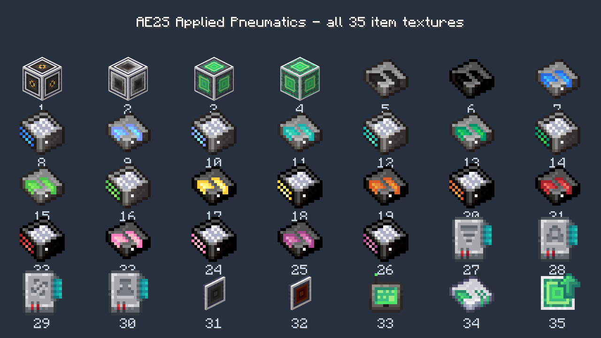

# 改名后渲染资源自查

安装包运行环境为正式 Cleanroom 0.4.0、Java 25、固定 AE2S `1.1.0+a47dfe029` 与 PNC `0.11.15-398`。
每组 `runtime.json` 记录实际安装包与依赖的哈希，`result.json` 记录执行结果。

| 场景 | 安装包 | 检查与结果 |
| --- | --- | --- |
| `textures-baseline` | 发布的 `.3` | 默认物品、方块和驱动器元件模型全部通过 |
| `textures-vintagefix` | 发布的 `.3` | 加入 VintageFix 0.7.2，默认模型全部通过 |
| `textures-cloud-build` | GitHub Actions 构建的 `.3` | 加入 VintageFix 0.7.2 + StellarCore 1.6.8，默认模型全部通过 |
| `textures-previous-namespace-negative` | 发布的 `.3` | 明确请求旧命名空间模型时失败：`appliedpneumatics:models/item/me_pressure_interface_block.json` 不存在，符合负向预期 |
| `textures-fix-optimized` | 修复的 `.4` | 两套命名空间、35 个物品、12 个方块状态、10 档驱动器元件、两类 P2P 通过；原版全物品截图正常 |

前三组说明自查环境未复现用户报告的全部缺材质，不代表用户整合包没有问题。
负向检查明确覆盖上版丢失的旧资源路径；`.4` 同时保留新旧资源，并将渲染绑定到稳定的原始路径。
没有修改或禁用用户整合包的优化 Mod，也没有清除用户缓存。

修复包的完整四组合玩法与资源重载验收见 [正式 0.4.0 验收](../README.md)。
这里只列模型专项检查，不能单独代替完整玩法验收。

